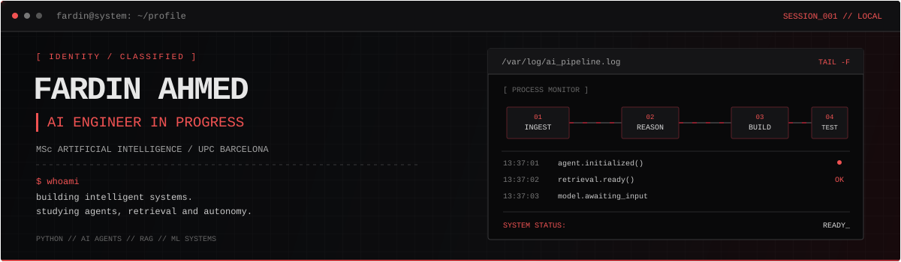

<p align="center">
  
</p>

<p align="center">
  
</p>

---

<blockquote>
  <code>Building intelligent systems, not just model demos.</code>
</blockquote>

## `01 / IDENTITY`

Computer Science graduate, currently pursuing an MSc in Artificial Intelligence at UB, UPC & URV.

Interested in practical AI engineering: connecting models, tools, data, and backend services to build useful systems.

Current areas of interest include agentic AI, retrieval-augmented generation, deep learning, and autonomous systems.

## `02 / TECH STACK`

<p>
  
  
  
  
  
  
  
  
  
  
  
  
</p>

```text
AREAS OF INTEREST
-----------------
[01] AGENTIC AI       / tool use, multi-step workflows, multi-agent systems
[02] RETRIEVAL / RAG  / embeddings, vector search, document retrieval
[03] DEEP LEARNING    / CNNs, image recognition, speech recognition
[04] BACKEND          / Python, FastAPI, REST APIs, Pydantic
[05] DATA             / SQL, processing, structured information
[06] SIMULATION       / Unity, AI behaviour, autonomous agents
```

## `03 / SELECTED PROJECTS`

<table>
  <tr>
    <td width="50%" valign="top">
      <h3><a href="https://github.com/fardinAhmed285/AI-Agent">AI-Agent</a></h3>
      Experiments with agentic AI, tools, language models, and multi-step workflows.
      <br/><br/>
      
      
    </td>
    <td width="50%" valign="top">
      <h3><a href="https://github.com/fardinAhmed285/RAGprodAPP">RAGprodAPP</a></h3>
      A retrieval-augmented generation application exploring document ingestion, vector search, and context retrieval for AI workflows.
      <br/><br/>
      
      
      
    </td>
  </tr>
  <tr>
    <td width="50%" valign="top">
      <h3><a href="https://github.com/fardinAhmed285/HandWrittenDigitRecognizer">HandWrittenDigitRecognizer</a></h3>
      Handwritten digit recognition using a convolutional neural network, with an interface for drawing digits and viewing predictions.
      <br/><br/>
      
      
    </td>
    <td width="50%" valign="top">
      <h3><a href="https://github.com/fardinAhmed285/Speech-Recognition-Using-CNN">Speech-Recognition-Using-CNN</a></h3>
      A deep-learning project exploring CNN-based speech recognition, audio processing, and model evaluation.
      <br/><br/>
      
      
    </td>
  </tr>
  <tr>
    <td colspan="2" valign="top">
      <h3><a href="https://github.com/fardinAhmed285/mia">MIA</a></h3>
      Explore the repository for its implementation, project scope, and documentation.
    </td>
  </tr>
</table>

## `04 / ENGINEERING PRINCIPLES`

```text
> BUILD_INCREMENTALLY
  Small components. Clear interfaces. Testable changes.

> VALIDATE_OUTPUTS
  Check assumptions. Evaluate results. Investigate failures.

> DESIGN_FOR_MAINTENANCE
  Modular code. Version control. Useful documentation.

> CONNECT_THE_SYSTEM
  Models + tools + data + APIs.
```

## `05 / GITHUB STATS`

<p align="center">
  
  
</p>

<p align="center">
  <a href="https://github.com/fardinAhmed285">
    
  </a>
</p>

## `06 / CONTACT`

<p align="center">
  <a href="https://www.linkedin.com/in/fardinahmed4074/">
    
  </a>
  <a href="mailto:ahmedfardin285@gmail.com">
    
  </a>
  <a href="https://github.com/fardinAhmed285">
    
  </a>
</p>

<p align="center">
  <sub><code>END OF TRANSMISSION_</code></sub>
</p>
